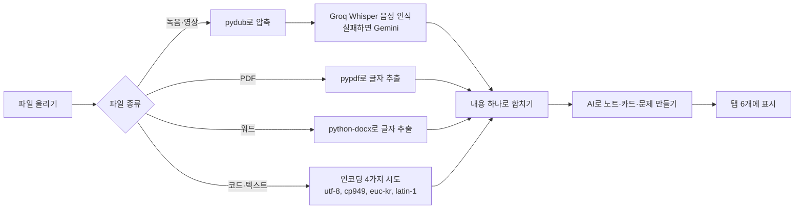

# Wald des Wissens (강의 노트 AI)

수업 녹음, 강의 영상, PDF, 워드 파일, 소스코드를 올리면 AI가 **요약 노트, 플래시카드, 예상 문제**를 만들어 주는 공부 도우미입니다. 파이썬(Streamlit)으로 만들었습니다.

이름 *Wald des Wissens*는 독일어로 "지식의 숲"이라는 뜻입니다.

## 만든 이유

수업을 녹음해 두어도 다시 들을 시간이 없었고, PDF와 녹음과 코드가 따로 흩어져 있어서 시험 전에 한 번에 정리하기 어려웠습니다. 여러 파일을 한꺼번에 올리면 한 장의 노트와 복습 문제로 바꿔 주는 도구가 있으면 좋겠다고 생각해서 만들었습니다.

## 기능

| 탭 | 하는 일 |
|---|---|
| 📝 통합 요약 노트 | 올린 파일 전체를 하나의 노트로 정리. 스타일 3가지(개조식, 설명형, 시험 직전 1분 요약) |
| 🎙️ 오디오 타임스탬프 | 녹음을 `[분:초]`가 붙은 대본으로 바꾸고, 원본을 바로 재생 |
| 💡 플래시카드 퀴즈 | 핵심 용어 5개와 암기용 Q&A 5개 |
| 🎯 예상 문제 | 객관식 3문제, 서술형 1문제와 정답·해설 |
| 💻 코드 실행 | 올린 C·파이썬 코드를 화면에서 바로 실행 |
| 💬 AI Q&A | 올린 내용을 바탕으로 질문하고 답 받기 |

그 밖에

- 학습 결과를 JSON 파일로 내려받고, 나중에 다시 불러올 수 있습니다.
- 녹음 파일은 보내기 전에 모노, 16kHz, 24kbps로 줄여서 큰 파일도 음성 인식 한도(25MB) 안에 들어가게 합니다.

## 동작 원리

### 전체 흐름



### 다중 AI 교차 검증

AI 하나만 쓰면 틀린 내용을 그대로 믿게 될 수 있어서, 기본 모드에서는 AI 세 개를 거칩니다.

1. Groq(Llama 3.3)가 첫 요약을 씁니다.
2. Gemini가 같은 내용을 따로 요약합니다.
3. Cerebras(Llama 3.1)가 두 요약을 비교해 하나의 최종 노트로 합칩니다.

빨리 보고 싶을 때는 "단일 AI 신속 분석" 모드에서 AI 하나만 고를 수 있습니다.

### AI가 응답하지 않을 때

무료 API는 사용량 한도에 자주 걸립니다. 그래서 `call_ai()`는 고른 AI가 실패하면 **Gemini → Cerebras → DeepSeek → Groq → OpenRouter** 순서로 다음 AI에 같은 요청을 보냅니다. API 키를 넣지 않은 AI는 건너뜁니다.

## 실행 방법

파이썬 3.9 이상이 필요합니다.

```bash
git clone https://github.com/siw0620/lecture-note-ai.git
cd lecture-note-ai
pip install -r requirements.txt
```

### API 키 넣기

키는 코드에 적지 않고 환경 변수로 넣습니다. 하나만 있어도 동작하고, 많을수록 교차 검증과 대체 순서가 제대로 돌아갑니다. 녹음을 글자로 바꾸려면 Groq이나 Gemini 키가 있어야 합니다.

| 환경 변수 | 받는 곳 |
|---|---|
| `GROQ_API_KEY` | console.groq.com |
| `GEMINI_API_KEY` | aistudio.google.com |
| `CEREBRAS_API_KEY` | cloud.cerebras.ai |
| `DEEPSEEK_API_KEY` | platform.deepseek.com |
| `OPENROUTER_API_KEY` | openrouter.ai |

윈도우 PowerShell:

```powershell
$env:GROQ_API_KEY="여기에_키"
$env:GEMINI_API_KEY="여기에_키"
streamlit run app.py
```

맥 / 리눅스:

```bash
export GROQ_API_KEY="여기에_키"
export GEMINI_API_KEY="여기에_키"
streamlit run app.py
```

브라우저에서 `http://localhost:8501`이 열립니다.

### 필요하면 추가로 설치할 것

- **ffmpeg**: mp4, m4a 같은 녹음을 압축할 때 pydub가 씁니다. 없으면 압축 없이 원본을 보냅니다.
- **gcc**: 코드 실행 탭에서 C 코드를 돌릴 때 필요합니다.

## 사용한 기술

- Python, Streamlit (화면)
- Groq Whisper large-v3 (음성 인식), Gemini (음성 인식 대체, 요약)
- Groq, Gemini, Cerebras, DeepSeek, OpenRouter (요약, 문제 만들기)
- pydub (녹음 압축), pypdf, python-docx (문서 읽기)

## 알아둘 점

- **코드 실행 탭은 격리되어 있지 않습니다.** 넣은 코드가 앱을 실행한 컴퓨터에서 그대로 돕니다. 내 컴퓨터에서 혼자 쓰는 용도로만 쓰고, 다른 사람이 접속하는 서버에 올리지 마세요.
- 올린 파일 내용은 요약을 위해 위의 AI 회사 서버로 전송됩니다. 개인정보가 담긴 녹음이나 문서는 올리지 않는 것이 좋습니다.
- AI가 만든 노트와 문제는 틀릴 수 있습니다. 교과서나 수업 자료와 함께 확인하세요.

## 만든 사람

정시우 · 서울로봇고등학교 · [github.com/siw0620](https://github.com/siw0620)
